# 当前数据库关系与页面取数

> [104_super_admin.sql](../db/migrations/104_super_admin.sql) 扩展 `users.role` 为 `super_admin`／`admin`／`member`。迁移从已有启用管理员中选取创建时间最早者；空库在旧 JSON 导入时提升一名管理员。唯一索引保证全库至多一个 SuperAdmin，CHECK 和触发器禁止其停用、软删除、降级与物理删除；普通管理员不能修改该账号。账号与登录会话的原有外键关系不变。

> [105_super_admin_candidates.sql](../db/migrations/105_super_admin_candidates.sql) 在 `users` 增加 `super_admin_candidate` 布尔列，仅 `admin` 角色可标记。它是由现任 SuperAdmin 管理的提名信息，不会创建第二名 SuperAdmin，也不会在登录鉴权中授予额外权限；无新表或外键。

> [106_note_ownership.sql](../db/migrations/106_note_ownership.sql) 给 `notes.owner_id` 增加指向 `users.id` 的外键，删除账号时置空并保留笔记。迁移前笔记不推断创建者，`owner_id` 保持空值：所有登录账号可读，只有 Admin／SuperAdmin 可编辑、删除或恢复版本。迁移后新笔记由登录账号持有，普通成员仅能修改自己的笔记。分类目录仍是全局资源，仅 Admin+ 可管理。

> 权限矩阵由服务端 `mock/permissions.mjs` 当前参与接口鉴权的资源规则生成，经 `/api/permissions/matrix` 提供给 `/permissions` 页面；它不新增数据库表。矩阵单元格包含范围值，记录级可见性仍由任务归属、笔记创建者和 SuperAdmin 保护条件进一步限制。未接入统一策略的模块不会凭空出现在矩阵中。

> 12.x 设置基础迁移见 [032_system_settings.sql](../db/migrations/032_system_settings.sql)，模型连接与安全审计见 [033_model_connections.sql](../db/migrations/033_model_connections.sql)，保留策略见 [034_retention_policy.sql](../db/migrations/034_retention_policy.sql)，备份作业见 [045_backup_jobs.sql](../db/migrations/045_backup_jobs.sql)；公开仓库连接、扫描与分析见 [046_project_repositories.sql](../db/migrations/046_project_repositories.sql)、[047_project_scans.sql](../db/migrations/047_project_scans.sql)、[048_project_scan_content.sql](../db/migrations/048_project_scan_content.sql)、[049_project_analyses.sql](../db/migrations/049_project_analyses.sql)、[050_project_model_audit.sql](../db/migrations/050_project_model_audit.sql)、[051_project_analysis_recovery.sql](../db/migrations/051_project_analysis_recovery.sql)、[052_project_analysis_modules.sql](../db/migrations/052_project_analysis_modules.sql)、[053_project_module_analysis.sql](../db/migrations/053_project_module_analysis.sql)、[054_project_suggestion_decisions.sql](../db/migrations/054_project_suggestion_decisions.sql)、[055_project_finding_feedback.sql](../db/migrations/055_project_finding_feedback.sql)、[056_project_technology_evidence.sql](../db/migrations/056_project_technology_evidence.sql)、[057_project_suggestion_priorities.sql](../db/migrations/057_project_suggestion_priorities.sql) 、[058_project_requirement_baselines.sql](../db/migrations/058_project_requirement_baselines.sql) 和 [059_project_finding_requirements.sql](../db/migrations/059_project_finding_requirements.sql)、[060_project_latest_analysis_idx.sql](../db/migrations/060_project_latest_analysis_idx.sql) 和 [061_project_repository_tasks.sql](../db/migrations/061_project_repository_tasks.sql)；会话用量、成本、上报归属与质量标记见 [062_session_token_usage.sql](../db/migrations/062_session_token_usage.sql)、[063_session_cost_snapshots.sql](../db/migrations/063_session_cost_snapshots.sql)、[064_session_ingest_ownership.sql](../db/migrations/064_session_ingest_ownership.sql) 、[065_session_quality_flags.sql](../db/migrations/065_session_quality_flags.sql) 、[066_session_clusters.sql](../db/migrations/066_session_clusters.sql) 和 [067_session_cluster_counters.sql](../db/migrations/067_session_cluster_counters.sql)；分析调用恢复见 [068_project_analysis_call_recovery.sql](../db/migrations/068_project_analysis_call_recovery.sql)。截至 [130_project_suggestion_adjustments.sql](../db/migrations/130_project_suggestion_adjustments.sql)，本机迁移后的数据库表共 147 张。

> [069_project_ownership_integrity.sql](../db/migrations/069_project_ownership_integrity.sql) 为项目分析增加复合外键，防止仓库、扫描、分析、建议决定在数据库层交叉归属；表数量不变。迁移遇到历史关联不一致时会报错，需先核对来源，不会自动改写旧记录。

> [070_project_report_provenance.sql](../db/migrations/070_project_report_provenance.sql) 进一步限制需求版本必须属于指向它的仓库，结论与建议及人工校正必须属于同一分析，校正账号必须是分析所属账号。删除需求版本时仅清空版本指针，不清空仓库或分析归属。

> [071_project_core_flows.sql](../db/migrations/071_project_core_flows.sql) 为报告增加核心流程和逐步代码证据两张关系表；旧报告的流程列表为空，不补造静态阅读时未记录的流程。

> [072_project_task_requirement_snapshots.sql](../db/migrations/072_project_task_requirement_snapshots.sql) 给仓库任务关联增加可选需求 ID，并为已完成报告增加任务状态快照表；快照中的任务 ID 无外键，历史任务被删除后仍保留当时的名称与状态。

> [073_project_suggestion_task_links.sql](../db/migrations/073_project_suggestion_task_links.sql) 将过去已接受建议创建、仍存在但未关联仓库的任务补入关联表；重复执行不产生重复关联，现有手工关联不被覆盖。

> [074_project_suggestion_existing_tasks.sql](../db/migrations/074_project_suggestion_existing_tasks.sql) 为建议决定增加 `target_mode`：接受时区分新建任务与关联已有任务，旧接受记录标记为新建；忽略决定保持空值，CHECK 约束校验状态组合。

> [075_task_dependency_restore_edges.sql](../db/migrations/075_task_dependency_restore_edges.sql) 保存任务软删除时被解除的下游依赖及原顺序；恢复时只接回依赖列表未被人工修改、且不会形成循环的边。永久删除任务时记录随外键级联清理。

## 系统设置与个人偏好

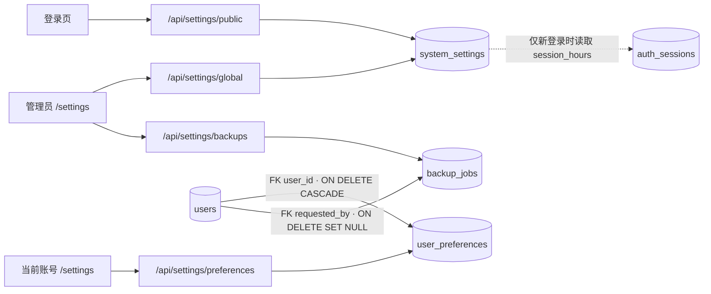

`system_settings` 是 ID 固定为 1 的单行全局配置，包含系统名称、公开 Logo URL、默认时区／语言／日期格式／分页条数和新登录有效期。`user_preferences` 以 `user_id` 为主键并外键关联 `users.id`；个人时区、语言和日期格式为空时继承全局值，主题、主色与密度按账号保存。两个设置写入接口均使用版本号拒绝过期覆盖。登录会话仍由 `auth_sessions` 保存，修改有效期不会改写旧会话的 `expires_at`。目前仅品牌、基础主题和主要列表分页使用这些设置；全站双语、统一日期展示及自绘图表主题仍在 12.1／12.6 的后续工作中。

`backup_jobs` 保存管理员手动备份的执行状态、阶段、文件大小和结果码，`requested_by` 外键指向 `users.id`，删除账号后置空。加密归档位于本地 `backups/`，文件名由作业 UUID 派生；密钥只从服务端环境变量读取，不存入数据库。后台作业启动时使用独立数据库连接生成 PostgreSQL dump，加入附件后验证加密归档；重启时未完成的作业标记为失败。自动备份、增量链和旁路恢复尚未实现。

## 出站 Webhook 事件与投递

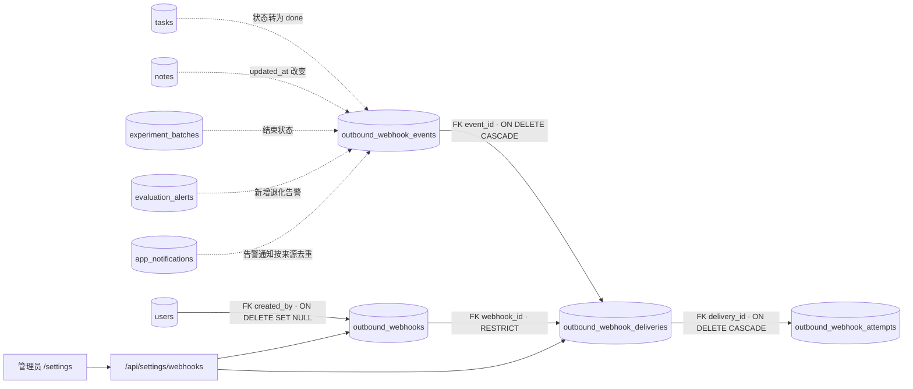

[076_outbound_webhooks.sql](../db/migrations/076_outbound_webhooks.sql) 建立四张表。业务表的触发器在同一事务中写事件；事件 `payload` 中的任务、笔记、批次及告警 ID 是历史快照字段，**没有指向业务实体的 SQL 外键**，因此源记录后来删除不会抹去待投递事件。[077_outbound_note_update_event.sql](../db/migrations/077_outbound_note_update_event.sql) 将笔记标题、正文、分类或标签保存导致的更新时间变化统一视为更新事件；[078_outbound_webhook_payloads.sql](../db/migrations/078_outbound_webhook_payloads.sql) 在入队时补入任务和笔记正文、批次运行汇总、告警明细。运行器按事件与当时启用的配置扇出投递；配置停用或软删除后取消尚未开始的投递，已发出的请求仍可能完成。投递表对配置使用默认限制删除的外键，删除配置只写 `deleted_at`，既有日志仍可由管理员查看；事件与逐次尝试分别级联清理下游记录。

普通 Webhook 的共享密钥和自定义 X- 请求头分别加密，数据库只存密文、nonce、认证标签、密钥版本及末四位掩码。投递前重新解析地址并固定实际连接 IP，拒绝内网目标和跳转；普通 Webhook 的签名覆盖时间戳与请求原始字节。队列状态与尝试次数持久化，进程重启后可恢复；网络断开后投递可能重复，普通 Webhook 接收方须按事件 ID 去重。[079_outbound_webhook_retention.sql](../db/migrations/079_outbound_webhook_retention.sql) 给每日清理结果增加 Webhook 事件清理数；审计保留期到达后只清理已扇出且没有待完成投递的事件，并级联其投递与尝试日志。

[080_outbound_notification_alerts.sql](../db/migrations/080_outbound_notification_alerts.sql) 把模型健康、预算阈值、日成本异常、速率与 token 配额、模型退役、实验／评测调度失败和评测仲裁通知接入 `alert.firing`。`app_notifications` 与 Webhook 事件之间没有 SQL 外键：通知正文、来源类型、业务 ID 在事务中复制到事件快照。`source_key` 对同一来源告警唯一，避免多个管理员的站内通知产生重复外发；个人 token 配额告警额外包含账号 ID，使不同账号的告警仍各自独立。评测退化已由 `evaluation_alerts` 触发器入队，故 `evaluation_regression` 站内通知不再重复入队。

## 任务 API 的账号边界

任务以 `tasks.owner_id` 判定归属：管理员可访问全部任务，普通账号只能访问归属自己的任务。旧数据若无归属，只向管理员开放，不自动推定为共享。任务列表、详情、工时、检查清单、标签、历史、批量变更、模板来源与重复序列入口均执行这条规则；未授权任务 ID 与不存在的 ID 同样返回 404。批量请求中出现不可见任务时整批不提交。普通账号的任务汇总和活动只计入可见任务；既有趋势进度快照是全局数据，普通账号不展示为个人历史平均值。旧数据中若保留跨账号依赖，普通账号的任务响应隐藏不可见的前置任务 ID 与标题。

笔记与手工实验仍按原有共享规则显示内容，但在查询、新建和修改任务关联时校验目标任务；无权访问旧关联任务的账号看到的 `taskId` 为 `null`，不能通过筛选取出该任务的关联记录，也不能移除该笔记或改写其关联。实验定义的独立接口也按同一规则校验写入并遮盖无权限任务 ID。知识图谱仅包含当前账号可见的任务节点，并省略隐藏任务的关联边。实验公开分享及创建前预览展示约定的提示词、参数和输出，不包含内部 `taskId`，避免持链接者据此猜测受限任务。版本链建议只在关联任务可见时返回同任务实验，确认链接时再次验证归属。会话正文现按上报账号隔离；评测报告分享及其他跨模块 ID 的访问规则仍待统一核查，因此整个 0.2 权限项尚未验收完成。

`/api/experiment-costs` 的总额、模型占比与 Top 10 统一按 `experiment_batches.owner_id` 限定普通账号；管理员查询全部批次。它与仅管理员可查看、按账本汇总的 `/api/model-costs` 职责不同，不能把前者的全局数字直接暴露给所有成员。

## 模型连接与安全审计

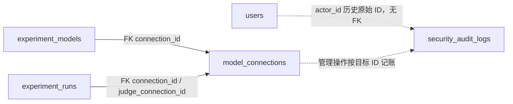

`model_connections` 可为同一供应商保存多条连接，只有一个启用的默认连接；API Key 和自定义 X- 请求头分别以 AES-256-GCM 加密，数据库行记录密钥版本与脱敏显示值。显式绑定的模型通过 `experiment_models.connection_id` 选择连接；创建运行时将主模型与 Judge 的连接 ID 复制到 `experiment_runs`，运行器按该 ID 取密钥。未绑定模型选供应商默认数据库连接，无默认连接才使用旧环境变量。`security_audit_logs` 是独立安全审计表，保存管理动作、操作者及目标 ID，不保存明文密钥；与任务字段历史、笔记版本历史区分。[036_model_registry.sql](../db/migrations/036_model_registry.sql) 扩展 `experiment_models` 的唯一名称、Endpoint／API 版本元数据、token 上限、能力标签、状态和角色白名单；[042_model_retirement.sql](../db/migrations/042_model_retirement.sql) 增加弃用、计划退役和实际退役时间，**不增加新表或外键**。旧模型保留成员可见权限；新增模型默认仅管理员可用。未接入的供应商只能登记目录，不能启用或执行；Endpoint 暂不覆盖加密连接的实际请求地址。运行单价仍按美元／百万 token 存储，管理表单换算显示美元／千 token。到期退役器按 `retire_at` 自动把状态改为 `retired`，排队运行标记失败；引用者通知存于 `app_notifications`，紧急退役写入 `security_audit_logs`。

[101 迁移](../db/migrations/101_account_audit.sql) 取消审计表操作者外键，使永久删除账号后仍保留原始账号 ID；登录记录插入时触发生成成功／失败审计。审计表触发器拒绝普通更新和删除。[108 迁移](../db/migrations/108_security_audit_retention.sql) 增加固定期限的安全定义清理函数，API／worker 可使用独立运行账号，权限配置见[审计运行角色](audit-runtime-role.md)。运行账号对审计表只能读取和追加；保留策略经该函数清理到期行，不能传入任意截止时间。主 API 的成功写请求同事务追加资源操作记录；图片、提示词媒体与 ZIP／外部同步、备份、项目仓库、扫描、分析、需求基线、人工校正和建议处理入口也按事务记账。备份文件下载先记录审计再传输。`/account-audit` 由管理员按账号／动作／资源／上海日期查询与导出，成员只能查询自己的记录。其他独立入口仍需核查；数据库所有者与主机管理员不受运行账号限制。

[102 迁移](../db/migrations/102_account_activity.sql) 给账号增加最近成功登录和不活跃标记，并建立 `account_page_views`。页面访问以账号、系统日历日和模块为复合主键；账号永久删除时级联删除访问统计。登录历史、审计和页面访问分别提供 30 天登录天数、操作次数及常访问模块；服务每小时标记连续 30 天未登录的启用账号。迁移前的页面访问不回填。

[103 迁移](../db/migrations/103_account_activity_baseline.sql) 为缺少可靠历史登录记录的旧账号设置活跃度启用时间；不活跃判断从最近成功登录或该启用时间起算，不把旧账号的创建时间冒充最近登录。

[107 迁移](../db/migrations/107_account_mfa.sql) 增加账号 TOTP 密钥、一次性恢复码哈希及短期登录挑战，三表均通过 `user_id` 外键关联 `users`，永久删除账号时级联删除。`auth_sessions.mfa_setup_required` 把尚未绑定的 Admin+ 会话限制在认证接口；现有 Admin+ 会话迁移时被标记为受限。TOTP 密钥及待绑定密钥分别以 AES-256-GCM 密文存储；恢复码只存 HMAC，使用后标记 `used_at`。登录挑战只保存随机令牌哈希、设备指纹哈希、5 分钟期限和失败次数；完成或过期后失效。

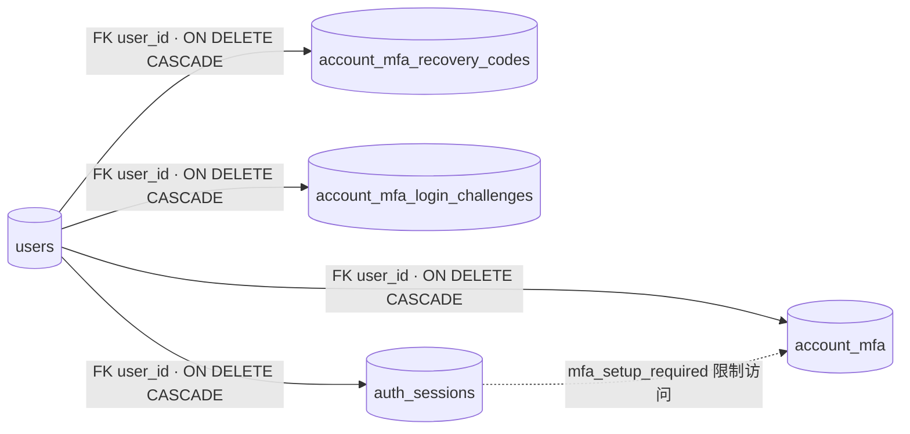

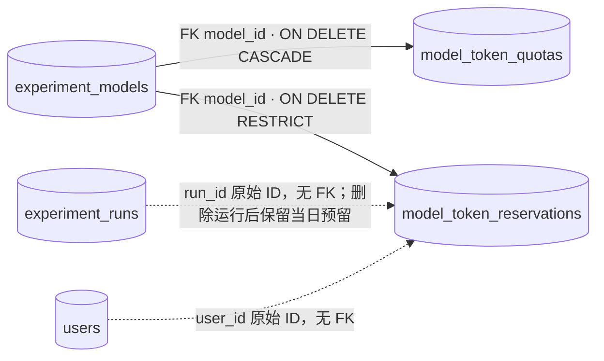

`model_token_quotas` 用 `(model_id, scope, subject_id)` 唯一定位模型默认、角色或账号规则；模型规则的 subject 为 `*`。优先级为用户 > 角色 > 模型，模型默认表示**每账号**的默认日上限。`model_token_reservations` 按 UTC 日期保存已接受运行的保守 token 上限；它故意不对运行或账号设外键，使删除运行或账号不会重置当天已占额度。主模型与 Judge 若相同，在同一运行内合并预留。入队在事务和数据库锁下检查总预留，超过上限返回 429 与下一 UTC 日的 `Retry-After`；达到 80%／90%／100% 生成去重站内通知。当前预留不会按实际结果回退，准确消耗核算须等 9.5 逐次调用审计完成；媒体模型配置配额前须设置上下文窗口，避免无界估算。

`model_rate_limits` 以模型 ID 为主键，外键到 `experiment_models.id`（删除模型时级联删除规则）。`model_rate_reservations` 以 `(run_id, model_id)` 为主键，`model_id` 外键到模型，`run_id` 为无外键原始 ID；每行保存 UTC 分钟、保守请求次数和 token 上限。`/api/model-rate-status` 只汇总当前分钟。批次入队与日配额使用相同事务，在另一个数据库锁下检查 RPM／TPM；任一超限整批返回 429 和下一分钟 `Retry-After`。超过 90% 的分钟按模型去重通知管理员。旧分钟预留在后续批次入队时清理；实际调用与失败释放仍待 9.5。

`model_call_audit` 以 UUID `request_id` 为主键，记录实际模型 HTTP 调用的运行 ID、主模型或 Judge 环节、尝试次数、账号 ID、模型 ID、模块、脱敏提示词预览、token 用量、延迟、HTTP 状态与失败代码。模块允许实验、评测及项目分析；项目分析审计只记录“仓库代码输入已省略”占位符，不复制仓库正文。运行、模型和账号 ID 故意不设外键，永久删除业务实体后在保留期内仍可核对调用。`/model-call-audit` 只允许管理员检索；聊天端会话尚未接入本地模型适配器，因此无可信调用事实可写。模型审计和独立安全审计日志都按 `retention_settings.audit_days` 清理，默认 90 天。

`model_security_policies` 以 `model_id` 为主键及指向 `experiment_models.id` 的级联外键，按模型保存输入 PII／越狱、输出 PII 开关与敏感词／品牌风险词表及并发版本。`model_security_events` 保存模型和运行原始 ID、主模型或 Judge 环节、输入／输出方向、命中规则及阻断／替换动作，**不保存命中原文且不设模型或运行外键**，使历史审计可保留至配置的审计期限。管理员通过模型设置抽屉读取和修改策略；模型调用适配器先检查文本输入，再调用提供商，返回文本输出时执行替换。媒体内容与工具参数尚未扫描。

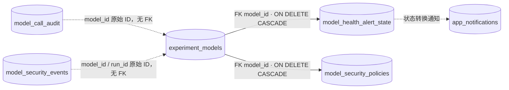

`/model-health` 用最近五分钟 `model_call_audit` 的请求计算 QPS、延迟分位数和 5xx 比例；没有调用记录只能显示“暂无调用”，不能推断提供商在线。`model_health_alert_state` 记录每个模型上次是否异常及转换轮次，模型删除时级联清除；定时检查仅在从正常转为异常时给管理员写入 `app_notifications`，避免每五秒重复通知。通知和状态表之间没有 SQL 外键。

[082_alert_metric_samples.sql](../db/migrations/082_alert_metric_samples.sql) 新增 `alert_metric_samples`。API 每分钟聚合会话用量、拒答和负面标注、模型最近五分钟 HTTP 错误率／延迟分位数／QPS、最近一小时评测通过率和均分，以及上海日历日成本与月预算使用率，写入以指标、范围和分钟为键的样本，保留 30 天。无调用或无评分的比率不写成 0；日用量与日成本可以为 0。`scope_id` 对模型仅保存原始 ID，**没有外键**，模型删除后样本可在保留期内继续用于历史分析。管理员可经 `/api/alerts/metrics` 读取样本；规则计算见下一段。

[088_alert_rate_rejections.sql](../db/migrations/088_alert_rate_rejections.sql) 建立 `model_rate_rejections`，保存实验执行和项目分析被 RPM／TPM 拒绝的事实、用量与来源模块；`user_id` 是管理账号外键，账号删除时置空，`model_id` 保留原始 ID 而无模型外键。演练式 dry-run 不计入拒绝事件。拒绝后每分钟按模型生成最近五分钟次数指标，供告警规则配置，历史事实按审计保留天数清理。

[083_alert_rules.sql](../db/migrations/083_alert_rules.sql) 建立 `alert_rules`、`alert_rule_state` 和 `alert_incidents`。规则包括指标、比较符、阈值、持续秒数、级别、站内／邮件渠道和启用状态；八个内置规则默认关闭。采样完成后按规则和实际模型范围判断，连续越界到达持续时间时仅创建一条活跃事件和首发通知；恢复时结束事件。[084_alert_escalation.sql](../db/migrations/084_alert_escalation.sql) 为事件增加升级时间；仍处于触发状态的 Warning 在 30 分钟未确认后升级为 Critical，并另发站内及可选邮件通知。修改或停用规则会结束旧事件并清空连续越界状态。`alert_rules.created_by` 和 `alert_incidents.acknowledged_by` 指向账号且删除时置空；`alert_rule_state.rule_id` 删除时级联；`alert_incidents.rule_id` 删除时置空以保留历史。规则与样本按指标及模型原始 ID 在代码中对应，**没有跨表 SQL 外键**。管理员在 `/alerts` 管理规则、查看样本与事件；处置时间线由下一段说明。

[085_alert_disposition.sql](../db/migrations/085_alert_disposition.sql) 为事件增加 `assigned_to` 管理端账号外键（账号删除时置空），并建立 `alert_incident_events` 操作时间线。时间线关联事件使用级联删除，操作人关联账号使用置空；保存触发、升级、确认、指派、备注和解决的实际时间及说明。迁移只根据旧事件已有的时间字段补入可确认的历史步骤。管理员在告警处置抽屉中指派、备注及手动解决。

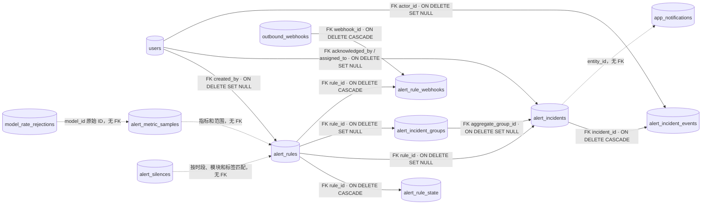

[086_alert_repeat_notifications.sql](../db/migrations/086_alert_repeat_notifications.sql) 给规则增加 `repeat_minutes`（默认 30，允许 1–1440 分钟），给事件增加最近提醒时间，并把 `reminded` 纳入时间线。只有仍处于 firing 的 Warning／Critical 会重复提醒；确认或解决即停止。升级通知也重置重复提醒计时，避免同一分钟重复发送。

[087_alert_silences.sql](../db/migrations/087_alert_silences.sql) 为规则增加自定义标签，并建立 `alert_silences`。静默规则按 IANA 时区的每日分钟区间、全部／模块／标签范围匹配，支持跨午夜；仅抑制 Warning 的通知，事件和时间线继续写入，Critical 不静默。`created_by` 指向管理账号，删除账号时置空。

[089_alert_aggregation.sql](../db/migrations/089_alert_aggregation.sql) 为规则增加默认五分钟的再次触发聚合窗口，建立 `alert_incident_groups`，并由 `alert_incidents.aggregate_group_id` 外键归组。相同规则和范围在窗口内恢复后再次触发时，新事件仍保留独立处置时间线，但组计数增加；已有首发通知时只更新其正文中的组内次数。若整个静默时段内尚无首发通知，静默结束后窗口内再次触发时可发送第一条。聚合组的 `rule_id` 在规则删除或修改后置空，历史事件依然可查。迁移只把旧事件各自建为单独的组，不推测旧通知是否应聚合。

[090_alert_rule_webhooks.sql](../db/migrations/090_alert_rule_webhooks.sql) 建立 `alert_rule_webhooks`，两侧分别以级联外键指向告警规则和已有的出站 Webhook 配置。规则可选择多个 `alert.firing` 配置；通知生成时只为这些配置建立投递记录，事件标记为已分发，避免通用广播队列再发送给其他钩子。`app_notifications.show_in_app` 区分邮件队列记录与顶部铃铛可见记录，未选站内渠道时不计未读数。

[132_enterprise_alert_webhooks.sql](../db/migrations/132_enterprise_alert_webhooks.sql) 为出站配置增加渠道类型和 AES-256-GCM 加密的机器人完整地址。数据库 `target_url` 和配置接口只保留脱敏展示地址；完整地址中的机器人访问令牌只在服务端解密投递，不进入事件正文与投递日志。企业微信、飞书、钉钉配置仅允许 `alert.firing` 事件及对应平台的固定 HTTPS 主机和路径；保存与投递时均重新解析公网地址并固定连接 IP。同平台可创建多个配置，以独立配置 ID 关联告警规则；编辑现有配置不可更换渠道，需另建配置。普通 JSON Webhook 继续使用原有 HMAC-SHA256 签名；企业机器人使用平台默认 URL 令牌和各自的文本消息格式，不附加本系统 HMAC。应用层非零错误码也进入现有重试队列，最多四次尝试。[133_enterprise_webhook_headers.sql](../db/migrations/133_enterprise_webhook_headers.sql) 以约束禁止机器人配置保存自定义请求头；普通 Webhook 的请求头能力保持不变。钉钉当前按关键词安全模式接入，平台额外加签模式及真实账号送达留待最终验收；停用或删除配置会取消尚未开始的投递。

[131_alert_session_refusal_rate.sql](../db/migrations/131_alert_session_refusal_rate.sql) 将 `session_refusal_rate` 加入规则和指标样本的约束，并为近一小时 Assistant 消息查询建索引。该指标以近一小时**有 Assistant 回复的会话**为分母，以其中至少一条回复被标记拒答的会话为分子；没有可计会话时不写零值样本，避免把缺少数据误判为零拒答率。原有 `session_refusal_streak` 仍单独表示最近五个会话的拒答数。

Info 级别只留事件；Warning 按所选渠道投递且可被静默；Critical 无论规则是直接设定还是从 Warning 升级，都会给管理员创建站内通知，并给已启用邮箱的管理员排队发邮件。规则选定的出站 Webhook 会另外收到相应的触发、升级或重复提醒事件。

管理员可在告警页面创建仅发给自己的站内或邮件测试通知，并查询邮件队列状态；邮件测试要求个人收件邮箱已启用且 SMTP 已配置。出站 Webhook 设置页的“测试投递”只给选定钩子写入一条无真实业务数据的测试事件和投递记录，管理员可通过原有投递日志查看重试与最终结果。

告警历史接口按触发时间、状态和级别从 `alert_incidents` 分页查询；分析接口以同一事件表按上海日历日和当前级别聚合趋势，按 `metric` 前缀统计模块，按指标名统计类型。MTTA 是已有确认时间与触发时间的平均差，MTTR 是已有解决时间与触发时间的平均差；尚未确认或解决的事件不参与相应平均值。

规则导出是版本 1 的 JSON 快照，只包含选中规则的配置和内置模板键，不包含事件、通知或账号信息。导入先预览每条规则将新增、跳过、覆盖或被拒绝；管理员选择同名处理方式后确认。后端在同一事务中复核模型引用、名称冲突和预览时的目标版本，任何无效行或并发变化都拒绝整批写入。覆盖内置规则按固定模板键匹配，不生成同名副本；历史事件继续保留。

规则保存前的预览只读 `alert_metric_samples` 最近 7 天样本，用与实际引擎相同的比较符、持续时间和两分钟采样间隙规则计算预期触发。返回样本覆盖范围、触发次数、首次触发时间及上海日历日分布；缺少完整 7 天历史时明确标记。预览不创建事件或通知，也不推断尚未采集的历史值。

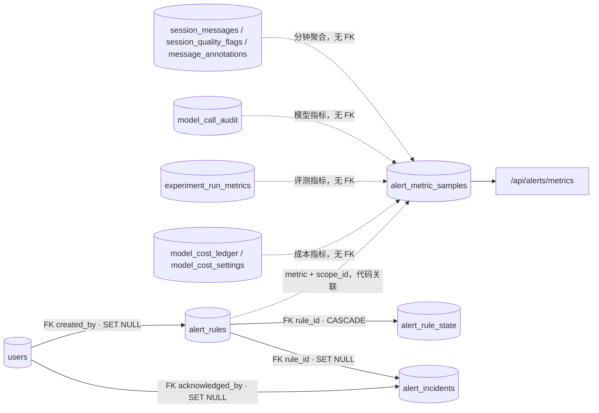

`/model-costs` 经 `/api/model-costs` 读取 `model_cost_ledger`。迁移时把已有 `experiment_runs.cost_usd` 减去 `judge_cost_usd` 归主模型，Judge 部分归 Judge 模型；之后数据库触发器在费用写入时同步两部分。账号取批次 `owner_id`，`dataset`／`regression` 批次归评测模块，其余归实验模块。账本以 `(run_id, part)` 为主键，**故意不对运行、模型、账号设外键**，因此删除原记录后已记账费用仍保留；模型或账号删除后显示原始 ID。旧运行账务时间取完成时间或创建时间，新费用以写入账本的 UTC 时刻记账。运行费用字段与账本金额均使用 12 位小数。

`model_cost_settings` 是 ID 固定为 1 的无外键单行表，保存美元月预算及并发版本。运行批次完成后，服务按 UTC 月累计已记账费用，对 80%／100%／120% 生成按月份去重的管理员通知；今日成本超过前七个完整 UTC 日的平均值三倍时生成按日期去重的异常通知。零预算关闭预算阈值通知，历史运行仍进入报表。

## 保留策略与每日清理记录

`retention_settings` 是单行版本化保留配置，保存独立安全审计保留天数、会话保留天数、核心内容回收天数以及系统时区下的清理时间。`retention_cleanup_runs` 以本地日历日为主键，记录每日清理结果和逐项永久删除失败原因，避免重启后重复执行。清理器删除过期 `security_audit_logs`、`client_error_reports` 与 `sessions`；会话删除级联消息和评分，未审核候选同时删除，已审核候选和摘录笔记保留并显示“原会话已清理”。[035_core_recycle_bin.sql](../db/migrations/035_core_recycle_bin.sql) 给 `tasks`、`notes`、`experiments` 增加 `deleted_at`；`prompt_library` 已在旧迁移中有该字段。删除后正常读取过滤已删除行，管理员可恢复或永久删除；到期清理按行设置保存点，关联约束阻止删除时保留条目并记录失败。恢复实验不会恢复已撤销的分享或暂停的调度；恢复任务会根据 `task_dependency_restore_edges` 尝试接回被解除的依赖，冲突时只恢复任务并报告未接回的依赖，迁移前删除的任务没有可追溯边记录。这两张保留策略表无外键。

[081_client_error_reports.sql](../db/migrations/081_client_error_reports.sql) 为页面渲染异常增加最小诊断记录。`client_error_reports.user_id` 是指向 `users.id` 的真实外键，删除账号时置空；报告只保存页面路径、错误类型及组件名，不保存错误正文、原始堆栈或 URL 查询参数。分享链接中的令牌路径段会替换为 `:token`。`POST /api/client-errors` 要求登录，按账号限制每分钟最多 20 条；记录与安全审计共用可配置的保留天数。

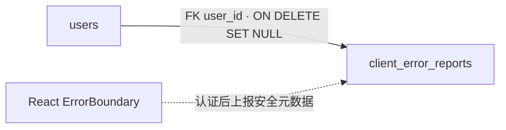

本文对应当前的 [建表迁移](../db/migrations/001_initial.sql)、[补充约束迁移](../db/migrations/002_constraints.sql)及后续版本化迁移，最新为 [130_project_suggestion_adjustments.sql](../db/migrations/130_project_suggestion_adjustments.sql)。本机当前共 **147 张表**。关系图中的**实线是数据库外键**，**虚线是应用代码使用的 ID 关联，没有数据库外键**；第一张图展示请求流向，箭头不代表外键。表中提到的页面路径以当前 [路由配置](../src/App.tsx) 为准。

## 项目分析连接

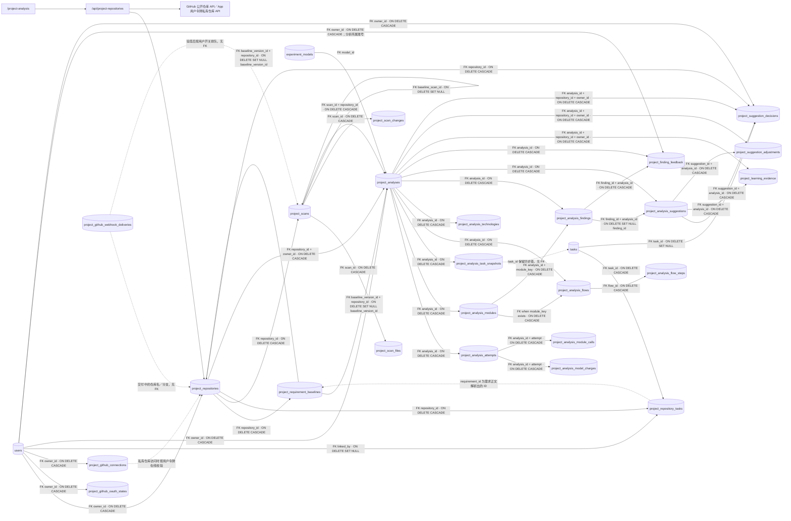

`project_repositories` 保存公开或已授权私有仓库的规范名称、`is_private` 和 `webhook_scan_enabled` 标记、分支、项目目标、需求基线文字、最近读取的 commit SHA 和读取时间；`owner_id` 是管理端账号外键，删除账号时级联清除连接。唯一索引限制同一账号重复接入同一仓库分支。列表与详情都按当前账号过滤，猜测 UUID 不会读到其他账号的连接。`last_checked_at` 表示读取分支的时间，不代表完成分析的时间。最近分析时间及对应 commit 从该仓库最近一条已完成的 `project_analyses` 查询得出，仓库本体不另存可过期副本；[060 索引迁移](../db/migrations/060_project_latest_analysis_idx.sql)用于按完成时间检索。

`project_scans.trigger_source` 区分手动与 Webhook 来源；只有仍排队且两分钟内由 Webhook 创建的扫描可合并后续提交，手动扫描的固定 commit 不变。`project_github_webhook_deliveries` 以 GitHub 交付 UUID 为主键，记录经原始请求体 HMAC 验签后的事件、仓库名、分支、commit 与本次排队扫描数。一个交付可匹配多个账号的仓库记录，因此不以仓库 ID 建外键；未开启的仓库、标签事件和删除分支不会创建扫描。`project_repositories.webhook_scan_enabled` 默认关闭；自动模型分析由另一个默认关闭的开关控制；公开仓库可自动提交，私有仓库仅创建待逐次确认的分析，模型 ID 以外键指向 `experiment_models`，每次 token／美元上限随配置保存。扫描记录的自动分析状态和分析 ID 由应用维护，`project_analyses.trigger_source` 区分手动与 Webhook，部分唯一索引保证同一扫描至多一条 Webhook 分析。[127 迁移](../db/migrations/127_project_analysis_change_notifications.sql) 为自动报告增加持久通知处理状态；完整且可比的连续报告有重要变化时，后台事务向 `app_notifications` 写入一次通知。报告与通知间没有新增 SQL 外键，以分析 UUID 作去重来源 ID。[128 迁移](../db/migrations/128_private_webhook_analysis_approval.sql) 允许私有仓库保存待确认的自动分析配置；`project_scans.auto_analysis_state=approval_required` 表示必须由所属账号逐次确认代码范围和模型目的地，确认后才创建对应 Webhook 分析。

`project_github_oauth_states` 保存一次性随机授权状态与发起浏览器标记的哈希、发起授权的管理端账号及过期时间；`project_github_connections` 保存该账号对应的 GitHub 用户 ID、登录名、加密访问／刷新令牌和到期时间。两表的 `owner_id` 均指向 `users`，删除账号时级联清理。它们不与 `project_repositories` 建立 SQL 外键：连接可断开而历史仓库行保留。公开仓库仍走不携带凭证的读取路径；私有仓库登记、详情、扫描和模型分析按当前账号在线核验 GitHub App 用户权限；私有分析的确认范围与目的地快照保存在 `project_analyses.private_disclosure`，详见[GitHub App 授权边界](project-github-app.md)。

`project_repository_tasks` 以仓库 ID＋任务 ID 为复合主键，分别通过外键指向 `project_repositories` 和 `tasks`，删除任一实体时关联级联删除；`linked_by` 指向创建关联的账号，账号删除时置空。仓库所属账号可读取并移除其关联；新增关联只允许本人任务，管理员可关联任意未删除任务。任务与仓库不因关联而共享归属或改变任务正文。个人学习路线通过这些关联任务按 `task_dependencies` 排序，再按本人任务 ID 读取本人笔记和实验；会话仅通过本人笔记的 `source_session_id` 且由本人上报时显示。路线排序为读取时计算的视图，个人证据提交另有独立表；边界见[学习路线取数说明](project-learning-roadmap.md)。

`project_learning_evidence` 保存本人对固定报告建议提交的理解回答或实践记录；`(analysis_id,repository_id,owner_id)` 和 `(suggestion_id,analysis_id)` 是实际复合外键，删除报告或建议时级联清理。材料 URL 只是文本，不连接外部资源表；页面称其“待核验”，不存自动掌握评分。[129 迁移](../db/migrations/129_project_learning_evidence.sql)定义表与约束。

`project_suggestion_adjustments` 将仓库所属账号修改的实践和验收标准作为独立调整稿保存，保留模型生成的建议原文；`version` 支持并发检查，建议转任务时读取调整稿。它通过与学习证据相同的两组复合外键约束报告、建议和账号归属；删除报告或建议时级联清理。[130 迁移](../db/migrations/130_project_suggestion_adjustments.sql)定义表与约束。

关联上的 `requirement_id` 可为空；非空时由 API 对当前版本需求正文解析出的 ID 校验，并在更新时检查页面持有的版本 ID。它不是 SQL 外键，因为需求条目是不可改写文档中的文本标识；换版后旧对应关系保留并可重新指定。`project_analysis_task_snapshots` 在报告完成事务中保存当时关联任务的需求 ID、标题、记录状态、进度、版本和账号，不随任务后续编辑改变。快照中的 `task_id` 只作历史来源标识，故没有任务外键；报告读取时另行判断当前任务是否仍可访问。任务状态不作为代码功能已实现的证据。

用户接受分析建议时创建的学习任务会在同一事务关联该仓库；若建议关联了固定版本需求结论，也会带入对应需求 ID。旧的已接受任务由 073 迁移补关联，只有任务仍存在、归属账号相符且此前没有手工关联时才补写。

`project_requirement_baselines` 按仓库保存不可改写的需求正文、递增版本号及正文 SHA-256。`project_repositories.baseline_version_id` 指向当前版本；`project_analyses.baseline_version_id` 固定分析时版本。旧 `requirement_baseline` 文本只是标签，迁移不伪造旧文档正文。新增版本使用仓库行锁和预期当前版本检查；正文作为不可信材料进入模型输入，创建成功时在同一事务写操作审计。删除仓库会级联删除其需求版本与分析；两个版本指针删除时置空。

用户提交仓库扫描任务、创建／取消／重试分析任务时，业务行与 `security_audit_logs` 在同一事务提交；复用已有进行中任务不生成新的用户操作记录。扫描器和分析 worker 的内部状态变迁不归为账号操作。该审计表通过资源类型与原始 ID 记录关联，不对项目表设置 SQL 外键，以便项目删除后仍保留审计事实直到保留期结束。

`project_scans` 固定创建时的仓库名称、分支、commit 及文件数／总读取量预算，记录排队、扫描中、完整、部分或失败状态及各类覆盖计数。预算字段由 [111_project_scan_budgets.sql](../db/migrations/111_project_scan_budgets.sql) 添加，旧扫描按当时默认的 200 文件／5 MB 记录；恢复作业读取同一行的预算，不使用页面当前选择。进行中的相同仓库／commit 扫描由唯一索引合并；服务重启后排队或扫描中的作业重新运行。`project_scan_files` 以扫描 ID 与路径为复合主键，保存文件 Git SHA、大小、分类、读取状态、内容哈希及成功读取的 UTF-8 正文；非读取成功的记录由 CHECK 约束禁止保存正文。列表只返回索引字段，正文读取接口先验证当前账号拥有仓库连接。迁移前的旧扫描正文为空，需要重新扫描。

`project_scans.reused_count` 与 `cache_source_commit_sha` 由 [113_project_scan_blob_reuse.sql](../db/migrations/113_project_scan_blob_reuse.sql) 添加，记录从同一仓库较早扫描复用的正文数量与来源 commit。来源 commit 是历史快照文字，不是外键；旧扫描的复用数为 0。复用前仍核对当前树的 Git blob SHA、正文 SHA-256、大小和密钥规则，详见[扫描正文复用](project-scan-reuse.md)。

[115_project_scan_changes.sql](../db/migrations/115_project_scan_changes.sql) 为扫描增加全量重扫标记、基线扫描外键和基线 commit 快照；`project_scan_changes` 以扫描 ID＋顺序为复合主键，记录已索引文件的新增、修改、删除及相同内容重命名。删除基线扫描时外键置空，但历史 commit 文字与已保存差异仍保留。详见[增量扫描差异](project-scan-changes.md)。

[117_project_scan_rate_retry.sql](../db/migrations/117_project_scan_rate_retry.sql) 在扫描头部保存限流重试次数和下次尝试时间，无新表或外键。排队状态跨服务重启恢复，跨进程咨询锁保证扫描请求串行；详见[扫描限流与恢复](project-scan-rate-limits.md)。

`project_analyses` 兼作后台任务和已完成报告的固定头部，保存账号、仓库、扫描、模型的外键，以及提交时冻结的仓库名称、分支、commit、目标、需求基线、供应商／模型和单价。相同扫描与模型的进行中任务由部分唯一索引合并；启动后排队任务会重新处理；分析中的任务按模块调用记录恢复，结果未知时停止。`attempts` 记录已发起的调用尝试，默认最多三次；`project_analysis_attempts` 以分析 ID＋次数为复合主键，外键指向主任务并级联删除，保存每次预算预估及累计用量。`project_analysis_module_calls` 以分析 ID＋次数＋模块名为复合主键，调用前记录 `started`，响应及费用入账时同事务改为 `completed`。`project_analysis_model_charges` 逐次保存模块模型调用的 token、费用和入账时间，并以分析 ID＋次数外键关联尝试；迁移时旧尝试的已知费用保留为单条调用。活跃预留持续占用当日预算，实际费用按每次调用的入账日统计。`project_analysis_modules` 以分析 ID＋目录模块名为复合主键，保存此次报告的索引、读取、入选、截断、排除、失败和未扫描文件数，以及成功分析的模块摘要；只在整份报告成功事务中写入，不为旧报告伪造历史选择。`project_analysis_technologies` 记录固定扫描中可读 `package.json`、`requirements.txt`、`pyproject.toml`、`go.mod`、`Cargo.toml` 明确依赖行的已知技术名称、包名、原始文件行与 Git SHA；它只提供有限的依赖声明线索，不证明运行或实际使用。`project_analysis_findings` 的可空 `module_key` 与分析 ID 一起引用模块，旧结论保持空值。新增可空 `requirement_id` 保存本次固定需求正文中提取的稳定 ID；它是报告内文本标识，不是 SQL 外键，旧结论保持空值。`project_finding_feedback` 逐条记录账号对结论状态的人工校正及理由，不改写模型判断与代码证据；报告按时间倒序展示全部记录。`project_suggestion_decisions` 以建议 ID 为主键，保存账号对建议的接受／忽略决定；接受时可在同一事务新建 `tasks` 行，或经字段差异预览和任务版本检查后，仅给已有任务描述追加实践、验收与来源；`target_mode` 标明新建或已有任务。数据库的部分唯一索引阻止同账号同仓库归一化文字指纹重复接受。任务被永久删除后 `task_id` 置空；删除报告或仓库时决定记录级联删除，任务本体仍保留。`canceled_at` 记录取消时间；取消时中断运行中请求，迟到结果不得写成成功报告。`project_analysis_findings` 逐条保存状态、说明和文件行证据；`project_analysis_suggestions` 保存实践任务与验收要求，可用外键指向关联结论，删除结论时置空。新报告还保存模型估计的影响等级、影响下一步开发的理由和前置知识数组；旧报告这些新增字段为空，不反推模型当时未给出的判断。子表随分析删除级联。分析结果在一个事务中写入；只有每个模块 JSON 结构及路径／行号／原文证据校验通过才置为已完成。当前模型调用由 API 进程内队列执行，并以 PostgreSQL 咨询锁防止跨进程并行接手。重启后已保存的模块响应可复用；调用结果未知时停止自动重发，需人工决定是否重试，仍无法保证供应商严格只计费一次。已经发出的请求取消后也可能由供应商计费，详见[分析调用恢复规则](project-analysis-recovery.md)。

`project_analyses.token_budget` 和 `cost_budget_usd` 由 [112_project_analysis_budgets.sql](../db/migrations/112_project_analysis_budgets.sql) 新增，作为可空的每作业上限；旧作业保持空值。提交与重试先检查预计用量，运行中在每次新模型调用前结合该作业历次实际消费复核，详见[分析预算](project-analysis-budgets.md)。

[114_project_analysis_call_cache.sql](../db/migrations/114_project_analysis_call_cache.sql) 为模块调用增加输入指纹、复用标记、来源报告 ID 与来源 commit，并为已完成调用建立指纹索引；分析头部增加模型连接版本及复用调用数。来源报告 ID 仅用于历史溯源，不设置 SQL 外键，避免旧报告清理后改变已保存的来源记录；当前分析与尝试的原有外键仍生效。详见[分析结果复用](project-analysis-cache.md)。

`project_analysis_flows` 按分析与模块保存模型提出的有序核心流程线索；跨模块流程的 `module_key` 为 `NULL`，其步骤必须引用至少两个不同目录模块。`project_analysis_flow_steps` 保存每个步骤的说明、代码或测试证据类型、文件路径、行号、原文及固定 Git SHA。每一步均需逐字匹配本次进入模型的源码或测试行；文档、目录名及无法定位的文字不能形成流程。流程与其他报告内容在同一事务中保存，任一步校验失败时整份报告不得置为成功。页面展示固定 commit 的行链接，并明确静态线索不是运行验收。`project_analyses.analysis_plan_version` 固定模型调用计划：版本 1 逐模块分析；版本 2 在至少两个模块有源码或测试证据时增加一次跨模块综合调用；该调用也进入调用记录、预算、费用和恢复逻辑。

[116_project_impact_plan.sql](../db/migrations/116_project_impact_plan.sql) 允许分析计划版本 3。版本 3 保留跨模块综合调用，并优先选择扫描差异及 JS／TS 一跳相对导入文件；受影响模块不复用跨报告输出。版本 1／2 作业恢复时仍使用原文件选择规则，详见[增量分析影响范围](project-analysis-impact.md)。

[118_project_multilanguage_impact_plan.sql](../db/migrations/118_project_multilanguage_impact_plan.sql) 允许分析计划版本 4。版本 4 增加 Python、Go 的本地导入线索和多跳反向引用追踪；版本 3 的选择规则保持不变，供已有分析任务恢复和重试。

[119_project_api_impact_plan.sql](../db/migrations/119_project_api_impact_plan.sql) 允许分析计划版本 5。版本 5 只根据明确的 API 路径字面量，为客户端请求和服务端路由建立应用层影响边；旧版本规则继续保留。

## 页面如何读写数据

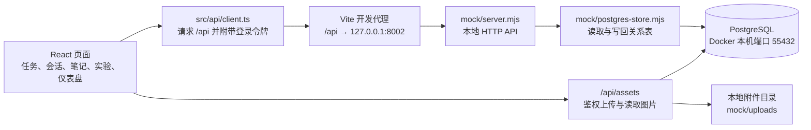

`mock` 是历史目录名，`mock/server.mjs` 现在提供实际的本地 HTTP 接口。`npm run dev` 同时启动它和 Vite。请求在同一个 PostgreSQL 事务中读取关系表为内存工作集，执行现有任务与会话规则，再把变化写回；批量操作、CSV 导入及重复任务生成也沿用事务。页面并不直接连接数据库，旧 `mock/db.json` 仅供显式一次性导入。该实现面向本地开发，尚未把每个列表和聚合改写成定向 SQL 查询，也不是生产部署服务。

## 任务、重复任务与模板

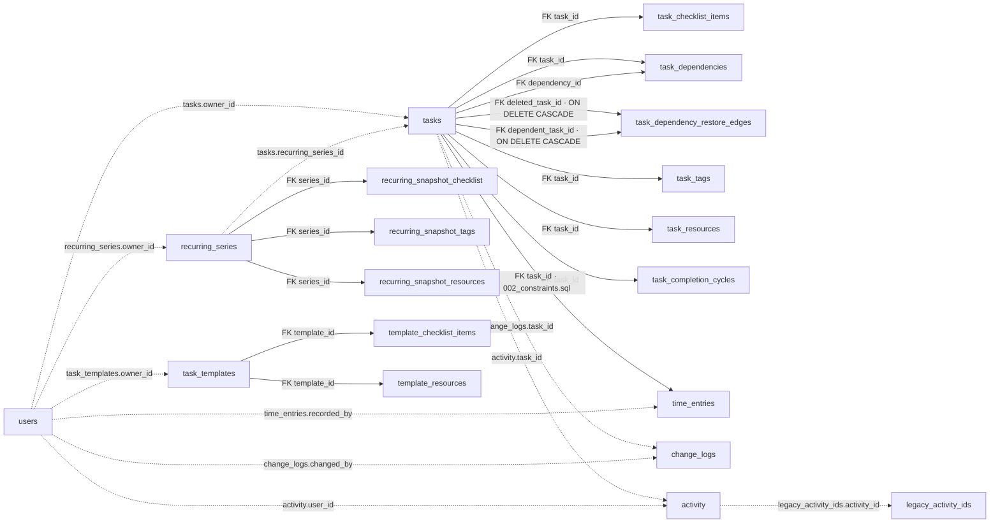

`task_dependencies` 的 `task_id` 与 `dependency_id` **分别**引用 `tasks.id`，因此图中有两条实线。`time_entries.task_id` 的外键由 [第二个迁移](../db/migrations/002_constraints.sql) 增加。`change_logs` 和 `activity` 为保留历史原始 ID，图中的任务／操作者连线只是逻辑关联；`activity` 也记录笔记和实验事件，并非只有任务事件。`legacy_activity_ids` 保存旧活动的 ID，同样没有外键。重复任务的实例通过 `tasks.recurring_series_id` 和 `recurrence_index` 指向序列；数据库为两者组合设置唯一索引，但 `recurring_series_id` 目前没有外键。删除某次任务不会自动删除或停止序列。

`task_dependency_restore_edges` 记录软删除任务时从仍活跃的下游任务移除的前置边、原顺序和下游任务删除后的依赖列表。恢复时对照这份列表：若另一端仍在回收站，记录暂留到其恢复；若下游依赖被人工改动或重新接边会形成循环，就跳过并向管理员展示原因，不覆盖后续手工编辑。恢复成功的边进入 `change_logs` 与 `activity`。多条前置任务反向恢复时会更新尚待恢复的对照列表，保留原顺序；永久删除任一端时记录级联消失。

| 表 | 当前内容与关键关系 | 对应页面或功能 |
| --- | --- | --- |
| `tasks` | 任务实例；含状态、进度、日期、归属、版本、重复序列 ID 和次数。`owner_id` 是逻辑关联。 | `/tasks`、`/tasks/:id`、仪表盘 |
| `task_checklist_items` | 任务清单项；`task_id` 外键，删除任务时级联删除。 | 任务详情、模板创建 |
| `task_dependencies` | 每行表示一个“任务 → 前置任务”；两个任务 ID 都有外键，任一端删除时该关系被删除。 | 任务详情、看板阻塞状态、甘特图 |
| `task_dependency_restore_edges` | 暂存任务软删除时解除的依赖、原顺序和下游依赖列表；两个任务 ID 均为级联外键。 | 管理员回收站恢复任务 |
| `task_tags` | 任务标签；`task_id` 外键，支持多标签筛选。 | 任务列表、详情、看板 |
| `task_resources` | 任务资源链接；`task_id` 外键。 | 任务详情 |
| `task_completion_cycles` | 每次完成／重开周期；`task_id` 外键。 | 任务详情的历时信息 |
| `time_entries` | 手动工时段与时长；`task_id` 外键由 `002_constraints.sql` 添加，`recorded_by` 仅保存账号 ID。 | 任务详情、仪表盘工时偏差 |
| `change_logs` | 任务字段变更和回滚历史；`task_id`、`changed_by` 为逻辑关联，旧值和新值为 JSONB。 | 任务详情“历史记录” |
| `recurring_series` | 频率、截止条件、下一次序号、账号状态自动暂停标记和后续任务的字段快照；任务／账号 ID 为逻辑关联。 | 任务编辑、重复实例生成 |
| `recurring_snapshot_checklist` | 后续实例使用的清单文字；`series_id` 外键。 | 重复实例生成 |
| `recurring_snapshot_tags` | 后续实例使用的标签；`series_id` 外键。 | 重复实例生成 |
| `recurring_snapshot_resources` | 后续实例使用的资源；`series_id` 外键。 | 重复实例生成 |
| `task_templates` | 用户保存的任务模板；`owner_id` 为逻辑关联。 | 创建任务时选择模板 |
| `template_checklist_items` | 模板清单；`template_id` 外键。 | 从模板创建任务 |
| `template_resources` | 模板建议资源；`template_id` 外键。 | 从模板创建任务 |

## 实验定义与执行基础

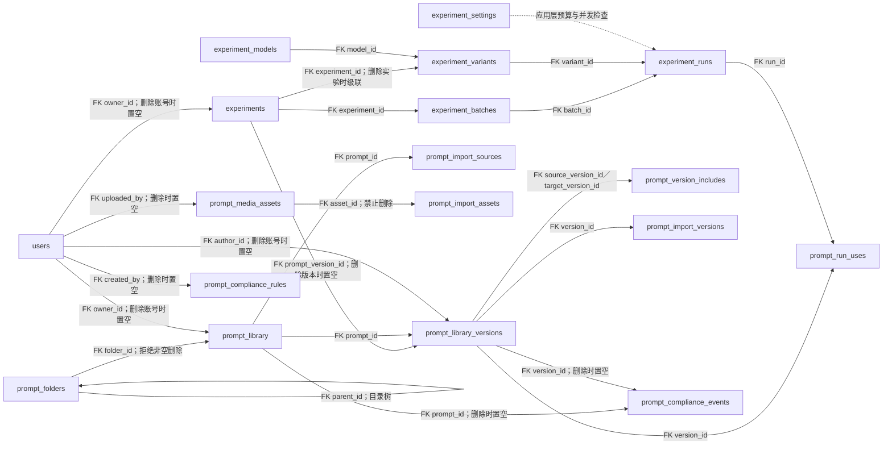

`experiments.record_kind` 区分未迁移内容的 `manual` 与可执行的 `definition`。旧手工记录保留原文、自评分和时间，缺少可靠创建者时只有管理员可管理。新定义的 `owner_id` 是真实账号外键；`task_id` 仍仅是逻辑关联。变体更新会停用旧变体并新建变体，旧运行继续引用原变体。运行保存请求时使用的提示词、参数、模型 API 名称、输入／输出单价快照及最终 token／延迟／成本，防止之后修改配置改写历史。运行队列依靠数据库状态在服务重启后恢复；模型密钥只在服务端环境变量中。

| 表 | 当前内容与关键关系 | 对应页面或功能 |
| --- | --- | --- |
| `experiment_settings` | 单行每日预算、并发上限和预留的 Judge 模型 ID。 | 实验管理员配置 |
| `experiment_models` | 唯一名称、供应商、能力、状态、角色白名单和美元／百万 token 内部单价；可绑定加密连接。 | 实验变体选择、成本快照、治理目录 |
| `prompt_library` | 提示词条目、标签、文件夹及软删除标记；创建者与文件夹为外键。 | `/prompts`、实验表单提示词来源 |
| `prompt_library_versions` | 不可变版本快照；旧整数版映射为 `0.0.N`，正文、类型、变量、消息结构和作者随版本保存。`prompt_id` 外键。 | `/prompts/:id`、实验定义选择固定版本 |
| `prompt_version_includes` | 固定版本间的直接引用边；源和目标版本均有外键。保存时检查引用链的循环与变量定义冲突。 | 提示词详情双向引用、运行时展开 |
| `prompt_run_uses` | 每次实验运行对直接及间接引用版本的归因事实；运行和版本均有外键，失败运行亦保留。 | 提示词版本统计、热度分析 |
| `prompt_import_sources` | 外部来源键和来源条目 ID 到本地提示词 ID 的稳定映射；重复导入避免复制。 | JSON/YAML 导入 |
| `prompt_import_versions` | 来源版本 ID 到本地不可变版本的映射；保持固定版本引用可重映射。 | JSON/YAML 版本导入 |
| `prompt_media_assets` | 本地受控图片、音频、视频附件元数据；上传账号有可置空外键，消息块中的附件 ID 由应用层校验。 | 提示词消息片段与实验运行 |
| `prompt_import_assets` | ZIP 来源键和附件 ID 映射到本地媒体，保存来源 SHA-256；同来源重复回导时复用附件，哈希变化则拒绝。`asset_id` 为外键。 | 提示词媒体 ZIP 回导 |
| `prompt_folders` | 可无限嵌套的共享目录；`parent_id` 自引用外键，非空目录不能删除。 | 提示词库侧栏 |
| `prompt_compliance_rules` | 管理员配置的受限自定义敏感信息模式。 | 提示词库合规管理 |
| `prompt_compliance_events` | 被拦截或明确确认后的扫描审计；提示词、版本与账号外键可置空。 | 提示词保存审计 |

LangFuse／LangSmith 的手动只读同步沿用 `prompt_import_sources` 和 `prompt_import_versions` 的来源映射及提示词合规扫描，不新建外部数据表。服务端凭据来自环境变量；复杂消息和无法无损映射的媒体版本会在预览中列为跳过，不落入数据库。
| `experiment_variants` | 一个实验定义的模型和参数组合；实验与模型均为外键。 | 实验详情、批量运行 |
| `experiment_batches` | 单次或 A/B 批次、变量输入、运行状态；实验和发起账号均为外键。 | 运行进度与汇总 |
| `experiment_runs` | 每个变体和输入组的独立执行、状态、响应、用量、主模型及 Judge 媒体价格快照；批次、实验和变体均为外键。 | 实验详情的运行结果 |

## 实验评测、标注、分享与调度

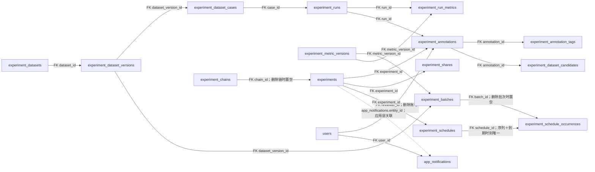

数据集版本固定用例清单，运行通过 `case_id` 记录对应输入。指标版本确定规则评分、Judge 提示词、通过门槛及退化阈值；规则和 Judge 的 0–5 分独立保存，再计算合成分。人工评分与自动分分开存储，人工标签只允许迁移中列出的七种值；标注可进入待审核候选池，不自动改写已发布数据集。版本链只在用户确认相似标题建议后设置稳定 `chain_id`。

分享表只保存随机令牌的哈希，公开页使用令牌查找最新配置和运行结果，过期或撤销后无法访问。调度记录以 `(schedule_id, due_at)` 唯一约束防止同一周期重复执行；账号时区用于计算下次运行时刻。`app_notifications.entity_id` 是应用层多类型关联，没有指向实验或调度的 SQL 外键；笔记复习仍保留原有专用通知表。

| 表 | 当前内容与关键关系 | 对应页面或功能 |
| --- | --- | --- |
| `experiment_metric_versions` | 规则类型、Judge 提示词、通过与退化门槛；由批次和运行指标引用。 | 回归设置与报告 |
| `experiment_datasets` | 数据集目录；创建账号外键可置空。 | `/experiments/datasets` |
| `experiment_dataset_versions` | 不可变的版本标识；`dataset_id` 外键。 | 数据集版本选择 |
| `experiment_dataset_cases` | 稳定用例键、变量、参考答案、难度与分类；版本外键。 | 回归逐项比较 |
| `experiment_run_metrics` | 单次运行的规则、Judge 和合成评分；运行与指标版本外键。 | 回归报告、自动评分 |
| `experiment_annotations` | 人工星级；实验、具体运行和评分账号外键，账号删除后匿名保留。 | 实验输出评分 |
| `experiment_annotation_tags` | 人工标签；标注外键和七值 CHECK。 | 实验输出标签 |
| `experiment_dataset_candidates` | 标注衍生的待审核候选；实验、运行、标注均为外键。 | 数据集候选池 |
| `experiment_chains` | 用户确认后的稳定版本链；创建账号外键。 | `/experiments/chains/:id` |
| `experiment_shares` | 只读分享的令牌哈希、期限、撤销时间；实验与创建者外键。 | `/share/experiments/:token` |
| `experiment_schedules` | 时区、频率、变量、重试、连续失败次数和下次执行时间；实验与账号外键。 | `/experiments/schedules` |
| `experiment_schedule_occurrences` | 每个计划周期与批次的持久关联；调度与批次外键。 | 定时运行恢复及去重 |
| `app_notifications` | 实验事件站内通知及可选邮件发送状态；账号外键。 | 顶部铃铛 |

## 评测数据集增量关系（019–020）

[019_evaluation_datasets.sql](../db/migrations/019_evaluation_datasets.sql) 新增文件夹、用例媒体引用，并扩展旧实验数据集；[020_evaluation_metrics.sql](../db/migrations/020_evaluation_metrics.sql) 扩展指标规则、分词版本和固定目标范围。图中实线均为 SQL 外键。

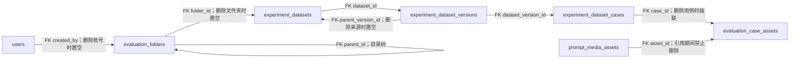

| 表 | 当前内容与关键关系 | 对应页面或功能 |
| --- | --- | --- |
| `evaluation_folders` | 无限层级目录；`parent_id` 自引用，非空目录不能删除。 | `/experiments/datasets` 文件夹浏览 |
| `evaluation_case_assets` | 用例与媒体附件的去重关联；两个 ID 都有外键，附件被引用时不能删除。 | 多模态用例保存、媒体配额核算 |

`experiment_dataset_cases` 现在还保存结构化输入、可选结构化参考答案、上下文、标签、1–5 难度、来源及期望工具调用。旧 `variables` 和 `reference_answer` 保留供已有实验运行读取。数据集子集保留创建时的固定 `parent_version_id`，来源版本的后续编辑不会改变子集。文件夹移动只更新目录元数据；用例内容修改必须新增版本。

## 自动运行、人工评测与退化告警（021–023）

[021_evaluation_run_details.sql](../db/migrations/021_evaluation_run_details.sql) 给运行指标增加逐项得分详情和重试上限；[022_evaluation_alerts.sql](../db/migrations/022_evaluation_alerts.sql) 保存退化告警；[023_evaluation_human_reviews.sql](../db/migrations/023_evaluation_human_reviews.sql) 保存双盲任务、分配和评分。

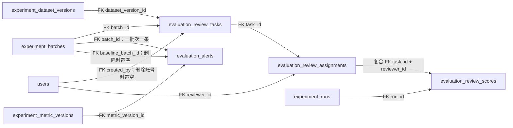

| 表 | 当前内容与关键关系 | 对应页面或功能 |
| --- | --- | --- |
| `evaluation_review_tasks` | 固定评测批次、数据集版本和四维评分标准；批次删除时级联。 | `/evaluation/reviews` |
| `evaluation_review_assignments` | 两位主评测员及争议后指派的仲裁员；任务和账号外键。 | 双盲待评队列 |
| `evaluation_review_scores` | 每账号每运行一份不可重复的四维 0–10 分；复合分配外键和运行外键。 | 一致性报告、争议仲裁 |
| `evaluation_alerts` | 单个回归批次的持久退化记录；关联固定 baseline 与指标版本。 | 退化告警和站内通知 |

`experiment_run_metrics.metric_details` 保存各内置指标的归一化得分、延迟与输出 token；`experiment_runs.retry_limit` 保存重试上限。跨版本比较使用 `case_key` 与输入、变量、上下文的指纹，数据库行 ID 只标识一个版本中的实例。双盲四维评分与实验输出的 1–5 星标注是不同数据，不能互相覆盖。

## 反馈候选与数据集发布（024–025）

[024_evaluation_candidates.sql](../db/migrations/024_evaluation_candidates.sql) 增加统一的会话／实验候选池；[025_evaluation_candidate_backfill.sql](../db/migrations/025_evaluation_candidate_backfill.sql) 将旧的 4–5 星标注补入候选池。候选来源标注 ID 因跨两种表而由应用层维护，图中虚线不是外键。

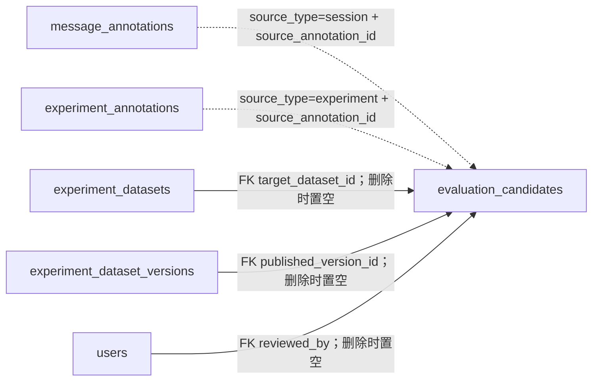

| 表 | 当前内容与关键关系 | 对应页面或功能 |
| --- | --- | --- |
| `evaluation_candidates` | 高分反馈的原始输入、输出、上下文、星级与审核状态；发布时指向目标数据集和新版本。 | `/evaluation/candidates` |

候选审核通过只进入暂存区，管理员的第二次操作将同一目标数据集的暂存条目批量追加到最新版本。原来的 `experiment_dataset_candidates` 仍保留供实验详情兼容读取；新的统一候选池同时收集会话反馈。

## 模型排行与定时评测（026–027）

[026_evaluation_metric_goals.sql](../db/migrations/026_evaluation_metric_goals.sql) 为指标版本保存固定目标区间。排行榜仅比较相同数据集版本与指标版本的已完成运行，按预设方向和区间归一化准确性、延迟和输出 token，再应用页面权重；不会依赖本次候选模型的最大最小值。[027_evaluation_schedules.sql](../db/migrations/027_evaluation_schedules.sql) 将计划和每次应执行的周期分开保存。

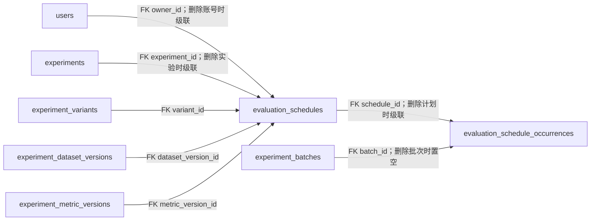

| 表 | 当前内容与关键关系 | 对应页面或功能 |
| --- | --- | --- |
| `evaluation_schedules` | 账号时区、每日／每周频率、固定数据集和指标版本、模型变体、下一执行时间；到期时行锁认领。 | `/evaluation/schedules` 创建、暂停、恢复、删除 |
| `evaluation_schedule_occurrences` | 每个计划时间唯一一条，记录批次与执行状态；重启补建时避免同周期重复提交。 | 立即执行、补建和失败通知 |

调度到期通过已有实验批次执行服务创建评测运行，逐项结果仍保存在 `experiment_runs` 和 `experiment_run_metrics`；通知保存在 `app_notifications`。删除计划会级联删除周期记录，已产生的批次和运行结果仍保留。排行榜页面为 `/evaluation/leaderboard`。

## 评测报告只读分享（028）

[028_evaluation_report_shares.sql](../db/migrations/028_evaluation_report_shares.sql) 增加一张报告分享表。分享链接只保存 SHA-256 令牌哈希、可选到期时间和撤销时间；创建人删除时置空，报告批次删除时级联。分享固定 `batch_id`，因此同批次的重试和结果更新反映在原链接，不会转到另一个批次。

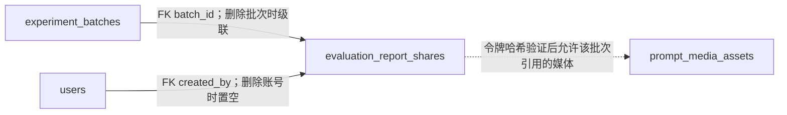

| 表 | 当前内容与关键关系 | 对应页面或功能 |
| --- | --- | --- |
| `evaluation_report_shares` | 固定报告批次、令牌哈希、期限和撤销状态；媒体权限通过运行用例与输出引用在应用层核查。 | `/experiments/reports/:id` 分享弹窗、`/share/evaluation-reports/:token` 公开页 |

## 评测媒体配额（029）

[029_evaluation_settings.sql](../db/migrations/029_evaluation_settings.sql) 新增单行配置表 `evaluation_settings`，默认全局 10 GB、单数据集 5 GB，要求磁盘至少保留 20% 空间；管理员可在数据集页面调整。该表没有外键。保存新版本前，API 会按附件去重计算占用，并核查引用权限：管理员可引用所有附件，普通成员只能引用自己上传的附件。版本和媒体引用仍由 `evaluation_case_assets` 保持外键约束。

## 隔离 Python 指标（030）

[030_evaluation_python_metrics.sql](../db/migrations/030_evaluation_python_metrics.sql) 新增 `evaluation_metric_scripts`，以稳定 ID 保存管理员登记的不可变 Python 源码，并由指标版本的 `custom_script_id` 外键固定引用；数据库约束要求 `custom_python` 规则必须引用脚本，其他规则不能引用。BERTScore 继续作为独立规则类型，运行时须有已构建的专用容器镜像。

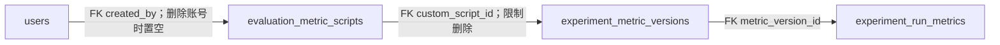

| 表 | 当前内容与关键关系 | 对应页面或功能 |
| --- | --- | --- |
| `evaluation_metric_scripts` | 不可变源码和创建人；指标版本通过外键固定脚本，运行结果保存在 `experiment_run_metrics.metric_details`。 | `/evaluation/metrics` 管理员登记和选择 |

## 逐指标退化阈值（031）

[031_evaluation_normalized_regression.sql](../db/migrations/031_evaluation_normalized_regression.sql) 给 `experiment_metric_versions` 增加固定的 `normalized_regression_threshold`，默认 0.2；没有新增表或外键。回归批次完成时按稳定 `case_key` 和输入指纹对齐 baseline，再将综合分、延迟、输出 token 与文本／工具指标映射到 0–1。每个超过阈值的指标都记入原有 `evaluation_alerts.details`，受影响用例数按 `caseKey` 去重。管理员从 `/evaluation/alerts` 查看告警、进入固定报告或导出带建议的 CSV；站内通知仍写入 `app_notifications`。

## 账号、会话与人工评分

```mermaid
flowchart LR
  ChatUser["聊天端用户 ID<br/>外部标识，不是本库表"] -. "sessions.external_user_id" .-> Sessions["sessions"]
  Users["users"] -->|"FK ingested_by；删除账号时置空"| Sessions
  Clusters["session_clusters"] -->|"FK cluster_id；删除组时置空"| Sessions
  ClusterSettings["session_cluster_settings"] -. "K 与 IDF 配置；应用层关联" .-> Clusters
  Sessions -->|"FK session_id"| Messages["session_messages"]
  Messages -->|"复合 FK session_id + message_id · ON DELETE CASCADE"| SessionPrices["session_usage_prices"]
  Messages -->|"复合 FK session_id + message_id · ON DELETE CASCADE"| QualityFlags["session_quality_flags"]
  Models["experiment_models"] -->|"FK model_id · ON DELETE SET NULL"| SessionPrices
  Messages -->|"复合 FK (session_id, message_id)"| Annotations["message_annotations"]
  Users -->|"FK user_id"| Tokens["auth_sessions"]
  Users -->|"FK user_id · ON DELETE SET NULL"| LoginHistory["account_login_history"]
  Users -->|"FK user_id · ON DELETE CASCADE"| PasswordHistory["password_history"]
  Users -->|"FK user_id · ON DELETE CASCADE"| PageViews["account_page_views"]
  Users -->|"FK user_id · ON DELETE CASCADE"| LoginSecurity["login_security_state"]
  Users -->|"FK created_by · ON DELETE SET NULL"| Invitations["account_invitations"]
  Users -->|"FK consumed_user_id · ON DELETE SET NULL"| Invitations
  Users -->|"FK reviewer_id；删除账号时置空"| Annotations
  Annotations -->|"FK annotation_id"| AnnotationTags["annotation_tags"]
```

消息 ID 只要求在**同一会话内**唯一；`session_messages` 的主键为 `(session_id, id)`。[062 迁移](../db/migrations/062_session_token_usage.sql) 在该表增加可空的 assistant 消息输入／输出 token 与模型名，并由数据库检查两个 token 字段同时存在且非负；旧消息保持缺失值。会话用量按明确上报的消息合计，口径见 [会话用量说明](session-token-usage.md)。评分表用 `(session_id, message_id)` 复合外键引用这两个字段。同一管理端账号对同一消息的有效评分由唯一索引限制为一条；删除评分账号时 `reviewer_id` 置空，原评分仍参与汇总。`annotation_tags.tag` 另有 [CHECK 约束](../db/migrations/002_constraints.sql)，只允许“准确、不准确、偏题、幻觉、过于冗长、过于简略、格式错误”七种标签。删除会话会级联删除消息、评分及其标签。`sessions.external_user_id` 不引用 `users.id`，不能把聊天端用户当成管理端评分账号。

[098 迁移](../db/migrations/098_account_recurring_pause.sql) 为重复序列增加由账号状态触发的暂停标记，区分自动暂停与用户手动停止；账号恢复启用时只恢复自动暂停的序列。账号永久删除时显式清理无账号外键的重复序列和任务模板，防止后台继续生成归属已不存在账号的任务。

[099 迁移](../db/migrations/099_account_login_history.sql) 为账号增加同时登录设备数上限，为令牌增加设备哈希，并新增登录记录表。登录记录保存连接 IP、User-Agent、设备分组哈希、结果与原因；[109 迁移](../db/migrations/109_login_geolocation.sql) 增加可空的国家、行政区代码和异地新设备标记。仅在配置本地 City MMDB 且新旧成功登录都能定位、设备指纹也变化时设置该标记；旧记录不反推地理位置。删除账号时 `user_id` 置空，历史记录仍保留到审计保留期结束。设备哈希来自浏览器环境提示，可被伪造，不能用于身份验证；登录 IP 默认取 API 连接地址；显式配置可信代理后才读取转发地址。GeoIP 代码只作风险提示，不作为鉴权依据。

[100 迁移](../db/migrations/100_account_ip_allowlist.sql) 给账号增加可留空的完整 IP 白名单数组。登录时在密码校验通过后检查来源 IP；仅显式列入 `TRUSTED_PROXY_IPS` 的直连代理可提供 `X-Forwarded-For` 最后一跳地址。新设备提醒复用 `app_notifications` 及可选 SMTP 邮件队列；该通知到账号、登录记录和设备哈希的关联由应用层维护，无新增外键。

[097 迁移](../db/migrations/097_account_purge_count.sql) 给每日清理记录增加永久删除账号数。账号保留期固定 30 天，不跟随核心内容回收天数变化；逐账号使用保存点，删除失败会留在回收站并记入 `purge_failures`，下次清理重试。

[096 迁移](../db/migrations/096_invitation_deleted_account.sql) 允许已用邀请的注册账号在未来永久删除后将 `consumed_user_id` 置空，同时保留邀请的已使用时间，不伪称该账号仍存在。

[095 迁移](../db/migrations/095_account_invitations.sql) 增加待激活状态和三种激活方式，并建立一次性邀请表。邀请只保存 UUID 令牌的 SHA-256 哈希；注册时在同一事务内创建账号、首条密码历史及复习计划，并标记邀请已使用。首次登录激活在密码校验成功后完成，手动激活由管理员操作。

[094 迁移](../db/migrations/094_account_soft_delete.sql) 为管理端账号增加软删除时间与删除前启用状态。删除时禁用账号并撤销令牌，外键关联仍保留；管理员可在回收站恢复原账号和原启用状态。满 30 天后自动永久删除，或由管理员二次确认立即删除；项目仓库、项目分析及复习进度等采用级联删除；登录历史、实验、提示词、会话和审核历史中的可空账号引用被置空。

`tasks.owner_id` 等早期应用级 ID 没有账号外键，账号永久删除时仍按历史值保留，任务只对管理员可见；它们不应被误认为数据库级联删除。任务模板和重复序列由清理器显式删除，已有重复任务本体保留。需要连同任务内容删除时应单独走任务回收站流程。停用或软删除账号时，活跃重复序列由应用标记为暂停；账号恢复启用后只恢复这些自动暂停的序列，原本手动停止的序列继续停止。实验及评测调度暂停后需手动恢复。

[093 迁移](../db/migrations/093_password_expiry_grace.sql) 为启用密码策略前没有可靠改密时间的旧账号重置 90 天宽限期；之后按最近一条密码历史计算到期，并在上海日历到期前 7／3／1 天生成站内提醒。到期账号只可改密、查看当前账号和退出，独立接口及 WebSocket 也拒绝过期令牌。

[092 迁移](../db/migrations/092_login_lockout.sql) 保存连续错误密码次数和锁定时间。第五次错误登录后锁定 15 分钟，管理员接收去重站内通知；成功登录清空失败状态，账号删除级联清理。

[091 迁移](../db/migrations/091_password_history.sql) 为每个旧账号保留当前密码哈希作为第一条已知历史，新建和重置密码时追加哈希。最近 5 次复用检查只在后端进行，密码明文不写入历史表或接口响应；已有更早的密码无法追溯。

[064 迁移](../db/migrations/064_session_ingest_ownership.sql) 新增 `sessions.ingested_by`，指向首次上报所用的管理端账号。只有该账号与管理员能读取、评分、搜索、导出、查看聚合或通过 `/api/sessions/ingest` 追加消息；笔记新建的来源会话 ID 也检查这个边界，共享笔记返回给其他账号时隐藏不可见的来源会话 ID。导入的旧会话没有可信上报账号，保持 `NULL`，仅管理员可访问；删除上报账号后该字段置空。主题聚类由全部会话计算，普通账号只能看到自己会话所处的匿名主题编号及本人会话数，避免全局标签泄露其他账号的问题内容。评测候选等衍生记录仍需分别核查来源 ID 的访问边界。

会话成本估算通过 [063 迁移](../db/migrations/063_session_cost_snapshots.sql) 的 `session_usage_prices` 保留首次上报时的价格；现价模式读取 `experiment_models` 当前价格，缺价消息单列而不当作零。两种口径及上海日历聚合见 [成本说明](session-costs.md)。会话全文搜索读取 `sessions` 与 `session_messages`，以数据库令牌验证管理端账号后使用独立的只读查询，不经过加载全部业务表的事务。普通关键词与正则模式、片段边界、查询时限及本机测量见 [会话搜索说明](session-search.md)。

`session_quality_flags` 由 [065 迁移](../db/migrations/065_session_quality_flags.sql) 建立，复合外键指向具体消息，并以 `(session_id, message_id, flag_type)` 防重。上报事件更新标记，迁移时回填旧消息；拒答和已上报输出 token 的超长标记规则见 [会话质量说明](session-quality.md)。

[066 迁移](../db/migrations/066_session_clusters.sql) 保存聚类 K、IDF、组中心和 `sessions.cluster_id` 外键；[067 迁移](../db/migrations/067_session_cluster_counters.sql) 增加已归类文档数与重算阈值。启动时补建旧会话分组，新会话按首条用户提问归入最近中心；管理员可重算并修改标签，规则见 [会话主题聚类](session-clusters.md)。

| 表 | 当前内容与关键关系 | 对应页面或功能 |
| --- | --- | --- |
| `users` | 管理端账号、密码哈希、角色、待激活／启用／停用状态、激活方式与时间、同时登录设备上限及 IP 白名单、可恢复删除时间及个人复习邮件设置。账号进入回收站时保留原 ID 和所有关联，但令牌立即撤销。 | `/login`、`/accounts`、`/notes/reviews` |
| `account_invitations` | 一次性邀请的令牌哈希、目标用户名、角色、激活方式、期限、使用与撤销时间；创建人和注册后账号均为可置空外键。明文令牌只在创建响应出现。 | `/accounts` 邀请管理、`/register` 注册 |
| `password_history` | 当前及历次密码的加盐哈希；`user_id` 外键，删除账号时级联删除。只供后端检查最近 5 次复用，不向页面返回哈希。 | `/accounts` 新建和重置密码、`/settings` 自助改密 |
| `login_security_state` | 按账号保存连续错误次数与锁定到期时间；`user_id` 外键，删除账号时级联删除。第 5 次错误锁定 15 分钟并产生管理员通知。 | `/login` |
| `auth_sessions` | 登录令牌哈希、设备分组哈希、到期与撤销时间；`user_id` 外键，删除账号时级联删除。 | 登录、退出、设备上限、HTTP／WebSocket 鉴权 |
| `account_login_history` | 登录成功／失败记录及连接 IP、User-Agent、原因；`user_id` 外键，删除账号时置空，随后按审计保留期清理。 | `/login`、个人设置最近登录记录 |
| `account_page_views` | 每账号／系统日期／模块的访问次数及最近访问时间，`user_id` 外键，账号永久删除时级联清理。 | `/account-activity` 团队活跃度 |
| `sessions` | 聊天端上报的会话；`external_user_id` 是外部用户标识，`ingested_by` 是管理端上报账号的可空外键。 | `/sessions` |
| `session_cluster_settings` | 单行 K、IDF、已归类文档数与重算阈值配置；与聚类为应用层关联。 | 会话聚类设置 |
| `session_clusters` | 聚类标签、自动标签、中心向量与成员数；`sessions.cluster_id` 指向它，删除组时置空。 | 会话主题筛选 |
| `session_messages` | 会话中的 user／assistant 消息，保留顺序和首次确定的 ID；`session_id` 外键；assistant 消息可存明确上报的输入／输出 token 与模型名。 | 会话行内预览、全文搜索、Token 用量 |
| `session_usage_prices` | 每条已上报消息首次匹配的模型与价格快照；消息复合外键级联删除，模型外键删除时置空。旧消息无快照不伪造历史价。 | 会话成本的「上报时价格」模式 |
| `session_quality_flags` | 指向触发拒答或超长输出标记的具体消息；复合消息外键级联删除，类型受 CHECK 限制。 | 会话质量标记与列表筛选 |
| `message_annotations` | assistant 消息的 1–5 星评分；复合消息外键及可置空的评分账号外键。 | 会话消息下的评分和汇总 |
| `annotation_tags` | 一条评分可选的多个标签；`annotation_id` 外键，`tag` 受 `002_constraints.sql` 的七种标签 CHECK 约束。 | 会话消息下的标签人数 |

## 关联内容、活动与迁移元数据

```mermaid
flowchart LR
  Notes["notes"] -->|"FK source_note_id；删除来源时级联"| Links["note_links"]
  Notes -->|"FK target_note_id；删除目标时置空"| Links
  Categories["note_categories"] -->|"FK parent_id；树形层级"| Categories
  Categories -->|"FK notes.category_id；删除分类时置空"| Notes
  Notes -->|"FK note_id；删除笔记时级联"| NoteTags["note_tags"]
  TagDefinitions["note_tag_definitions"] -->|"FK tag；改名／删除时级联"| NoteTags
  Notes -->|"FK note_id；删除笔记时级联"| Versions["note_versions"]
  Users["users"] -->|"FK user_id；删除账号时级联"| ReviewProgress["note_review_progress"]
  Notes -->|"FK note_id；删除笔记时级联"| ReviewProgress
  Users -->|"FK user_id；删除账号时级联"| ReviewEvents["note_review_events"]
  Notes -->|"FK note_id；删除笔记时级联"| ReviewEvents
  Users -->|"FK user_id；删除账号时级联"| ReviewNotices["note_review_notifications"]
  Notes -->|"FK note_id；删除笔记时级联"| ReviewNotices
  Notes -. "notes.task_id" .-> Tasks["tasks"]
  Notes -. "notes.source_session_id" .-> Sessions["sessions"]
  Experiments["experiments"] -. "experiments.task_id" .-> Tasks
  Notes -. "正文中的 /api/assets/:id" .-> Media["media_assets + 本地文件"]
  Tasks -. "描述/备注中的图片 URL" .-> Media
  Experiments -. "提示词/结果中的图片 URL" .-> Media
```

`note_links` 每行是一处正文引用，`source_note_id` 与 `target_note_id` 都有 SQL 外键。目标笔记删除后 `target_note_id` 置空，原引用文字和 `target_ref` 保留，页面显示红色虚线占位。`media_assets` 只存图片元数据，文件由本地 API 保存在 `mock/uploads/`；Markdown 字段里的图片 URL 是应用层引用，没有 SQL 外键。未被当前内容引用且已上传超过 24 小时的图片由服务定时清理。

`note_categories.parent_id` 形成可自定义的分类树，应用层拒绝间接循环；有子分类时不能删除父分类。删除叶子分类会把其笔记的 `category_id` 置空。`note_tag_definitions` 为每个笔记标签保存稳定 ID、显示名称和唯一规范化名称；`note_tags.tag` 通过名称外键引用它，改名和删除会级联到关联表。API 在同一事务中同步笔记标签数组，合并时去重。标签无笔记使用时仍留在目录和输入候选中，标签云只显示使用篇数大于零的标签。`note_tags` 与任务的 `task_tags` 完全分离；笔记列表可按分类及其子树、多个标签和标题／正文关键词组合筛选。

`note_versions` 每次保存标题和正文的完整快照，按 `(note_id, version_number)` 唯一；回滚会追加新版本。迁移前的笔记只生成当前内容的基线版本。知识图谱本身不另建表，`/api/knowledge-graph` 汇总 `notes`、`note_links`、`tasks` 和 `sessions`；笔记到任务和来源会话的关联仍由应用层维护。

下表中的笔记和实验 `task_id`、笔记 `source_session_id` 等字段用于当前页面的关联查询，但**没有 SQL 外键**。因此历史记录可以保留已删除实体的原始 ID；不能仅凭这些字段推断目标记录仍然存在。`note_links` 的两个笔记关联则有 SQL 外键。

| 表 | 当前内容与关键关系 | 对应页面或功能 |
| --- | --- | --- |
| `notes` | 笔记；`task_id`、`source_session_id` 分别记录关联任务和来源会话，均为逻辑关联。 | `/notes`、`/notes/:id`、任务详情“关联” |
| `note_categories` | 笔记分类树；`parent_id` 自引用外键。 | `/notes` 分类侧栏和分类管理 |
| `note_tag_definitions` | 笔记标签目录；稳定 ID、唯一名称及大小写归一键，允许零使用标签。 | `/notes` 标签候选与管理员管理入口 |
| `note_tags` | 笔记独立的多标签；`note_id` 和 `tag` 均有外键。 | `/notes` 标签云与筛选 |
| `note_links` | 笔记正文的双向引用；来源和目标均有外键，目标删除时保留悬空引用。 | `/notes/:id`、`/notes/graph` |
| `note_versions` | 每次保存或回滚产生的标题／正文快照；`note_id` 外键，删除笔记时级联删除。 | `/notes/:id` 历史版本、对比与回滚 |
| `note_review_progress` | 每账号每笔记一行；保存间隔阶段、轮次和到期日，账号与笔记均为级联删除外键。 | `/notes/reviews` |
| `note_review_events` | 每次完成复习的不可重复记录；账号、笔记均为级联删除外键，账号＋笔记＋轮次唯一。 | 复习面板勾选及历史核验 |
| `note_review_notifications` | 到期站内提醒、已读状态和邮件投递状态；账号、笔记均为级联删除外键，账号＋笔记＋轮次唯一。 | 顶部铃铛、邮件重试 |
| `media_assets` | 图片 MIME、大小、上传时间；文件存本地附件目录，内容字段通过 URL 逻辑引用。 | Markdown 编辑器及详情预览 |
| `experiments` | 手工记录或可执行实验定义；`task_id` 为逻辑关联，`owner_id` 与提示词版本为外键。 | `/experiments`、`/experiments/:id`、任务详情“关联” |
| `outbound_webhooks` | 管理员配置的事件、渠道类型、脱敏目标 URL、加密机器人完整地址及普通渠道共享密钥／请求头、启用状态；机器人禁止自定义请求头，`created_by` 外键在删除账号后置空。 | `/settings` 出站 Webhook 配置 |
| `outbound_webhook_events` | 事务内持久化的事件类型、时间和业务正文；业务实体 ID 是快照值，无实体外键。告警通知使用唯一 `source_key` 防止多账号重复外发。 | 后台投递队列 |
| `outbound_webhook_deliveries` | 每配置每事件唯一的投递状态、次数及下次时间；配置为限制删除外键，事件为级联删除外键。 | `/settings` 投递日志 |
| `outbound_webhook_attempts` | 每次 HTTP 请求的时间、状态码、脱敏响应及错误；投递为级联删除外键。 | `/settings` 投递日志展开行 |
| `activity` | 创建、修改、完成等活动摘要；任务和操作者 ID 为逻辑关联。 | 仪表盘最近活动、任务早期活动 |
| `legacy_activity_ids` | 标记从旧 JSON 带来的活动 ID，便于与新字段历史分开展示；无外键。 | 任务详情“早期活动” |
| `task_trend_events` | 任务创建／完成等趋势事件；`task_id` 为逻辑关联。 | 仪表盘趋势折线图 |
| `task_trend_snapshots` | 某时点任务总数与进度总和的快照；无实体外键。 | 仪表盘累计平均进度 |
| `schema_migrations` | 已执行的 SQL 迁移版本与时间。 | `npm run db:migrate` |
| `data_imports` | 旧 JSON 导入文件的哈希与导入时间，防止重复导入。 | `npm run db:import` |

早期的任务、会话和笔记表组之外，后续迁移还增加了实验、评测、模型治理、系统设置、项目分析、会话分析及页面错误报告等表，当前总数以本文开头的 147 张为准。复习表对账号和笔记使用真实外键；`generation` 是业务轮次，通过唯一约束防止重复提醒或复习记录，不是跨表外键。查看实际定义时以 SQL 迁移文件为准；图解释的是**当前实现**，未来添加外键或改变删除策略时，应同步更新本文。
